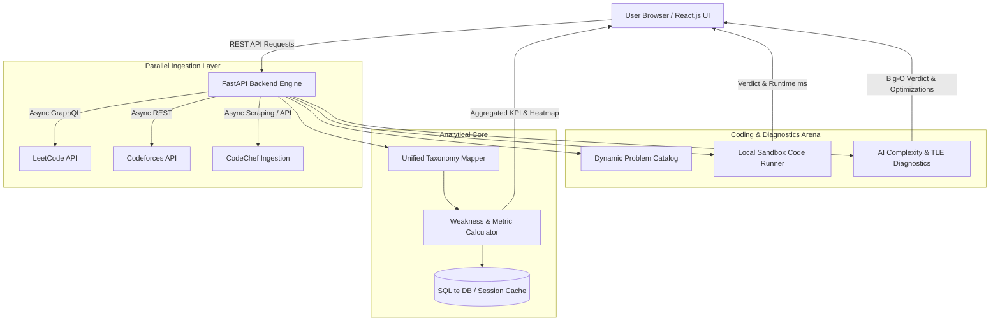

# ⚡ AlgoTrack AI
### *Universal Multi-Platform CP & DSA Intelligence Platform with In-App Code Execution & AI Diagnostics*

[](https://nodejs.org/)
[](https://react.dev/)
[](https://github.com)
[](LICENSE)

---

## 📌 Overview

**AlgoTrack AI** is a production-grade Competitive Programming (CP) and Data Structures & Algorithms (DSA) intelligence platform. It solves the fragmentation problem faced by software engineers and competitive coders who practice across multiple platforms (**LeetCode**, **Codeforces**, **CodeChef**). 

Instead of juggling disjointed profiles, AlgoTrack aggregates cross-platform metrics in parallel, unifies algorithmic taxonomies, identifies user-specific weak spots, and provides an **interactive In-App Practice & Revision Arena** equipped with real sandbox code execution and AI-driven asymptotic complexity/TLE root-cause diagnostics.

---

## ✨ Key Features

### 1. 🌐 Parallel Multi-Platform Aggregation
- **Unified Profile Ingestion:** Concurrently queries **LeetCode** (GraphQL API), **Codeforces** (REST API), and **CodeChef** via asynchronous I/O (`asyncio.gather`).
- **Flexible Handle Management:** Connect any combination of accounts (or leave unused platforms blank) without breaking analytical aggregation.
- **Cross-Platform Deduplication:** Dynamically cross-references solved problem sets across platforms to prevent redundant practice suggestions.

### 2. 📊 Cross-Platform Analytics & Weak Spot Engine
- **Unified DSA Taxonomy:** Maps varied platform tags (e.g., Codeforces `dfs and similar` vs. LeetCode `Depth-First Search`) into a standardized 10-category taxonomy.
- **Dynamic Weakness Detection:** Calculates topic-wise AC rates and historical submission volume to algorithmically detect performance bottlenecks.
- **Interactive Visualizations:**
  - 365-day Submission Heatmap (GitHub-style activity tracking).
  - Rating progression trajectory with contest timelines.
  - Multi-platform problem distribution donut & language distribution breakdown.

### 3. ⚡ In-App Coding Arena & Real Code Execution Engine
- **Dual-Mode Arena:**
  - **New Challenges Mode:** Guaranteed fresh, unseen challenges filtered by difficulty (Easy, Medium, Hard) and platform, with live access to a 9,000+ problem catalog.
  - **Revision Arena:** Fast-track revision bank of previously solved problems with verified optimal reference solutions.
- **In-App Problem Viewer:** Full-length problem statements, formatted input/output specifications, sample walkthroughs, and progressive hint disclosures.
- **Real Code Execution:** Local sandboxed runner for **C++** and **Python 3** with custom testcase evaluation, runtime (ms) measurement, and comprehensive verdicts (`Accepted`, `Wrong Answer`, `Runtime Error`, `TLE`).
- **Zero-Dependency Syntax Editor:** Custom single-pass deterministic lexer providing syntax highlighting and synchronized gutter line numbers without heavy external dependencies.

### 4. 🧠 AI Algorithmic Diagnostics (TLE / MLE Root-Cause Analyzer)
- **Big-O Complexity Estimator:** Computes asymptotic Time and Space complexities directly from code structure.
- **Bottleneck Explainer:** Pinpoints exact nested loops or recursion branches causing Time Limit Exceeded (TLE) or Memory Limit Exceeded (MLE) given the problem's constraints.
- **Optimization Roadmap:** Recommends optimal algorithmic paradigms (e.g., transitioning from $O(N^2)$ brute force to $O(N \log N)$ Two Pointers / Binary Search).

### 5. 🏆 Live Universal Contest Calendar
- **Dynamic Aggregation:** Aggregates scheduled rounds across **Codeforces, LeetCode, CodeChef, and AtCoder** for the upcoming 7 days.
- **Local Timezone Formatting:** Automatically formats contest start times, durations, and countdown timers relative to user locale.
- **1-Click Google Calendar Sync:** Direct calendar reminder links with pre-filled contest titles and URLs.

---

## 🏗️ System Architecture



---

## 🛠️ Tech Stack

| Domain | Technologies |
| :--- | :--- |
| **Frontend** | React.js (Vite), React Router DOM, Recharts, React Activity Calendar, Modern CSS Glassmorphism |
| **Backend** | Python 3.11+, FastAPI, Uvicorn, AsyncIO, HTTPX |
| **Database & Cache** | SQLite, SQLAlchemy (Async ORM), In-Memory Problemset Caching |
| **Code Execution** | Subprocess Sandbox Runner (C++20, Python 3), Multi-Testcase Evaluator |
| **APIs Integrated** | LeetCode GraphQL, Codeforces Official REST API, Kontests API |

---

## 🚀 Getting Started

### Prerequisites
- **Node.js 18+ & npm**

### 1. Backend Setup (Node.js & Express)
In your terminal:
```bash
cd Backend

# Install dependencies
npm install

# Start Express development server (Port 8000)
npm start
```
Backend API server will be live at: `http://localhost:8000`

### 2. Frontend Setup (React & Vite)
In a second terminal window:
```bash
cd Frontend

# Install packages
npm install

# Start Vite development server
npm run dev
```
Open your browser at `http://localhost:5173`.

---

## 📁 Repository Structure

```text
AlgoTrack/
├── Backend/
│   ├── routes/
│   │   ├── auth.routes.js          # Authentication (Register, Login, Me, Handles, Sync)
│   │   ├── leaderboard.routes.js   # College & coder ranking aggregations
│   │   ├── profile.routes.js       # LeetCode, Codeforces & CodeChef unified ingestion
│   │   ├── contests.routes.js      # Upcoming live contest calendar
│   │   └── practice.routes.js      # Practice challenges & AI diagnostics
│   ├── services/
│   │   ├── leetcode.js             # LeetCode GraphQL fetcher
│   │   ├── codeforces.js           # Codeforces REST API fetcher
│   │   ├── codechef.js             # CodeChef public scraper
│   │   ├── contests.js             # Live contest schedule aggregator
│   │   └── problems_bank.json      # Curated DSA problem statements
│   ├── middleware/
│   │   └── auth.js                 # JWT Bearer verification middleware
│   ├── db.js                       # SQLite database initializer
│   ├── server.js                   # Main Express application entrypoint
│   └── package.json                # Node.js backend dependencies
│
├── Frontend/
│   ├── src/
│   │   ├── components/
│   │   │   ├── Navbar.jsx          # Top header with user profile & college badge
│   │   │   ├── AuthModal.jsx       # Glassmorphism Login/Sign-up dialog
│   │   │   ├── CodeEditorWithSyntax.jsx
│   │   │   └── UpcomingContests.jsx
│   │   ├── pages/
│   │   │   ├── landing/            # Handle connection & setup page
│   │   │   ├── leaderboard/        # College Leaderboards (NSUT, DTU, IIIT-D)
│   │   │   ├── dashboard/          # Unified multi-platform dashboard
│   │   │   ├── practice/           # In-app practice & revision arena
│   │   │   └── contests/           # Standalone contest schedule viewer
│   │   ├── App.jsx                 # Routing & lazy-loaded pages
│   │   └── main.jsx
│   └── package.json
└── README.md
```

---

## 📝 Resume Bullet Points (Ready to Copy)

If you're showcasing this project on your resume or LinkedIn, here are high-impact bullet points:

- **Architected a Universal CP/DSA Platform:** Built a full-stack platform using **React.js** and **FastAPI** that concurrently aggregates coding metrics from **LeetCode, Codeforces, and CodeChef** using asynchronous I/O (`httpx`, `asyncio.gather`), eliminating profile fragmentation.
- **Cross-Platform Weakness Analytics:** Developed an algorithmic weakness detection engine standardizing multi-platform tags into a unified 10-category taxonomy, displaying 365-day submission heatmaps and rating progression curves with **Recharts**.
- **Real-Time Code Execution Engine:** Implemented an isolated sandbox execution runner supporting **Python** and **C++** with automated multi-testcase evaluation, runtime measurement, and automated verdicts (`Accepted`, `Wrong Answer`, `TLE`).
- **AI Algorithmic Diagnostics:** Built an automated heuristic analyzer assessing Big-O asymptotic time/space complexities and diagnosing root causes for Time/Memory Limit Exceeded (TLE/MLE) errors with alternative paradigm recommendations.
- **Dynamic Contest Intelligence:** Integrated a multi-platform contest tracker monitoring live schedules across Codeforces, LeetCode, CodeChef, and AtCoder with automated timezone conversion and 1-click Google Calendar reminders.

---

## 📄 License
This project is licensed under the MIT License - see the [LICENSE](LICENSE) file for details.
